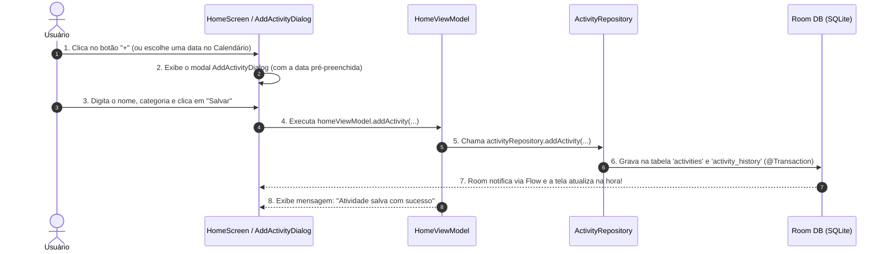

# LastTime ⏱️ - Controle de Atividades, Histórico e Kanban

**LastTime** é um aplicativo Android desenvolvido em **Kotlin** com **Jetpack Compose** e **Room Database (SQLite)**. Ele ajuda você a acompanhar o tempo decorrido desde a última vez que realizou determinada tarefa (*regar plantas*, *pagar contas*, *cortar o cabelo*), organizar sub-tarefas em um quadro **Kanban** por atividade e visualizar suas tarefas em um **Calendário nativo**.

---

## ✨ Funcionalidades Principais

- ⏱️ **Cálculo Automático de Dias**: Calcula e exibe quantos dias se passaram desde a última realização (`dias = hoje - última data`).
- ✅ **Marcação Rápida ("Hoje")**: Um clique no botão `CheckCircle` do card registra a tarefa como feita no dia atual.
- 📂 **Categorias Dinâmicas**: Organize suas atividades em abas (*Trabalho*, *Pessoal*, *Plantas*) e crie novas categorias diretamente pelo aplicativo.
- 📋 **Kanban por Atividade**: Cada atividade possui seu próprio quadro Kanban com 3 colunas fixas (*📌 Pendente*, *⏳ Em andamento*, *✅ Concluído*).
- 🚀 **Conclusão Automática via Kanban**: Ao mover **todas** as sub-tarefas do Kanban para *Concluído*, o app grava **automaticamente** que a atividade principal foi realizada no dia de HOJE!
- 📅 **Calendário Nativo (`CalendarView`)**: Integração do componente nativo do Android Studio. Tocar em um dia permite criar uma atividade injetando a data escolhida.
- 📜 **Histórico com Botão de Voltar**: Tela de histórico detalhada mostrando todas as datas passadas e suporte a navegação simples.

---

## 🏛️ Arquitetura MVVM Didática e Simplificada

O projeto adota a arquitetura **MVVM (Model - View - ViewModel)** estruturada para fácil leitura e aprendizado:

```
┌─────────────────────────────────────────────────────────┐
│                    VIEW (Interface)                     │
│    HomeScreen / HistoryScreen / CalendarScreen / Dialog │
└────────────────────────────┬────────────────────────────┘
                             │ (lê estados & chama funções)
                             ▼
┌─────────────────────────────────────────────────────────┐
│                  VIEWMODEL (Cérebro)                    │
│    HomeViewModel / HistoryViewModel / CalendarViewModel │
└────────────────────────────┬────────────────────────────┘
                             │ (pede dados)
                             ▼
┌─────────────────────────────────────────────────────────┐
│                 REPOSITORY (Regras)                     │
│                  ActivityRepository                     │
└────────────────────────────┬────────────────────────────┘
                             │ (lê e grava)
                             ▼
┌─────────────────────────────────────────────────────────┐
│              MODEL (Banco de Dados Local)               │
│          Room Database (SQLite) / DAOs / Entities       │
└─────────────────────────────────────────────────────────┘
```

### Papel de Cada Componente:
1. **Model (`data/local`)**:
   - `ActivityEntity`, `KanbanTaskEntity`, `CategoryEntity`: Criam as tabelas no SQLite.
   - `ActivityDao`, `KanbanTaskDao`, `CategoryDao`: Executam comandos SQL no banco de dados.
2. **Repository (`data/repository`)**:
   - `ActivityRepository`: Ponte entre o banco e as telas. Calcula dias decorridos e aplica a regra de auto-conclusão da atividade quando o Kanban é finalizado.
3. **ViewModel (`presentation/`)**:
   - `HomeViewModel`: Entrega as listas de atividades e categorias para a Home.
   - `HistoryViewModel`: Gerencia o histórico de datas e as 3 colunas do Kanban.
   - `CalendarViewModel`: Controla a data selecionada no calendário.
4. **View (`presentation/`)**:
   - Telas 100% declarativas construídas com **Jetpack Compose**.

---

## 🎯 Fluxo de Execução: "Adicionar Atividade & Kanban"



---

## 🛠️ Tecnologias Utilizadas

- **Linguagem**: Kotlin (2.2)
- **Interface**: Jetpack Compose (Material Design 3)
- **Componente Nativo**: Android Native `android.widget.CalendarView` via `AndroidView`
- **Arquitetura**: MVVM Simples (Model - View - ViewModel)
- **Banco de Dados**: Room Database (v2.8.5) com SQLite
- **Processamento de Anotações**: KSP (Kotlin Symbol Processing)
- **Navegação**: Navigation Compose (v2.9.7)
- **Rede HTTP**: Ktor Client (v3.4.3) para APIs externas
- **Testes**: JUnit 4 / Espresso

---

## 🚀 Como Executar o Projeto

1. Abra o **Android Studio** (versão Ladybug ou superior).
2. Clone ou abra esta pasta de projeto (`LastTime`).
3. Aguarde o **Gradle Sync** finalizar a instalação das dependências.
4. Conecte um emulador Android (API 26+) ou dispositivo físico via USB.
5. Clique no botão **Run (Shift + F10)**.
