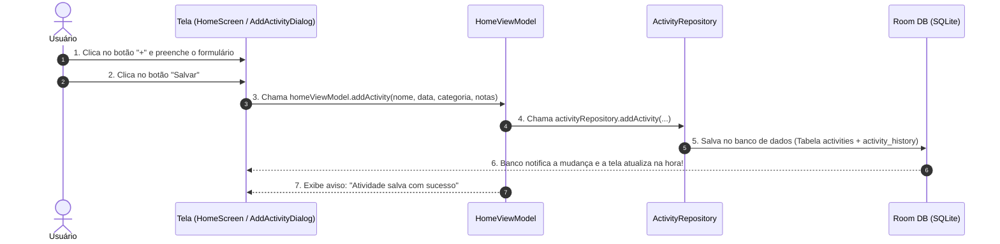

# LastTime ⏱️ - Aplicativo Android de Controle de Atividades

**LastTime** é um aplicativo Android em Kotlin projetado para acompanhar o tempo decorrido desde a última vez em que você realizou uma atividade (ex: *regar plantas*, *pagar contas*, *cortar o cabelo*).

---

## 🏛️ Arquitetura MVVM Simplificada Explicada para Iniciantes

O projeto utiliza a arquitetura **MVVM (Model - View - ViewModel)** de forma direta e sem complicações.

### Como funciona cada camada:

1. **M (Model - Dados e Banco)**:
   - Contém as tabelas e dados salvos no banco de dados local (Room SQLite).
   - *Arquivos*: `ActivityEntity`, `CategoryEntity`, `ActivityDao`.

2. **V (View - Tela e Interface)**:
   - É tudo o que o usuário vê na tela (desenhado com **Jetpack Compose**).
   - Quando o usuário clica em um botão, a Tela chama diretamente uma função na ViewModel.
   - *Arquivos*: `HomeScreen`, `AddActivityDialog`, `HistoryScreen`, `AppNavigation`.

3. **VM (ViewModel - O "Gerente" da Tela)**:
   - Fica no meio do caminho entre o Banco de Dados e a Tela.
   - Pega os dados do repositório e entrega prontos para a tela mostrar.
   - *Arquivos*: `HomeViewModel`, `HistoryViewModel`.

---

## 🎯 Fluxo Passo a Passo: "Adicionar uma Nova Atividade"

Entenda o caminho percorrido do clique do usuário até a gravação no banco de dados:



---

## 📋 Detalhamento Didático da Ordem de Execução

### Passo 1: O Usuário Acessa o Formulário (View)
- O usuário clica no botão **`+`** na barra inferior (`MemineBottomBar`).
- A tela abre o modal **`AddActivityDialog`** onde o usuário digita o **Nome**, escolhe a **Data**, a **Categoria** e digita **Anotações**.

### Passo 2: O Clique em "Salvar" (View -> ViewModel)
- Quando o usuário clica em **Salvar**, o código do formulário chama diretamente a função da ViewModel:
  ```kotlin
  homeViewModel.addActivity(
      name = nomeDigitado,
      date = dataEscolhida,
      category = categoriaSelecionada,
      notes = anotacoes
  )
  ```

### Passo 3: O Processamento na ViewModel (ViewModel -> Repository)
- A **`HomeViewModel`** roda em segundo plano (corrotina) e repassa os dados para o Repositório:
  ```kotlin
  activityRepository.addActivity(name, date, category, notes)
  ```

### Passo 4: Gravação no Banco de Dados (Repository -> Room DB)
- O **`ActivityRepository`** valida se o nome não está em branco e se a data não é no futuro.
- Em seguida, manda o banco de dados salvar os dados através do **`ActivityDao`**:
  ```kotlin
  dao.insertActivityWithHistory(name, date, category, notes)
  ```
- O banco de dados grava a atividade e insere a data inicial no histórico em uma transação segura.

### Passo 5: Atualização Automática da Tela (Room DB -> View)
- Como usamos **Kotlin Flow**, o banco de dados avisa a tela **automaticamente** que há novos dados.
- A **`HomeScreen`** redesenha a lista na hora, exibindo o novo card na categoria correta!
- Um aviso flutuante (**Snackbar**) confirma para o usuário: *"Atividade salva com sucesso"*.

---

## 🛠️ Tecnologias Utilizadas

- **Linguagem**: Kotlin
- **Interface**: Jetpack Compose (Material Design 3)
- **Arquitetura**: MVVM Simples (Model - View - ViewModel)
- **Banco de Dados**: Room Database (SQLite)
