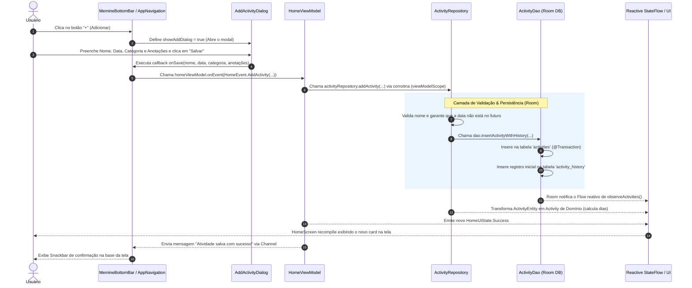

# LastTime ⏱️ - Aplicativo Android de Controle de Atividades

**LastTime** é um aplicativo Android desenvolvido em Kotlin com Jetpack Compose e Room Database, projetado para ajudar usuários a acompanhar o tempo decorrido desde a última vez em que realizaram determinada atividade (ex: *regar plantas*, *pagar contas*, *cortar o cabelo*).

---

## 🎯 Fluxo do Caso de Uso: "Adicionar uma Nova Atividade"

Abaixo está o detalhamento completo e em ordem cronológica de tudo o que acontece na aplicação ao clicar no botão para **Adicionar uma Atividade**.



---

## 📋 Ordem de Chamada e Responsabilidade de Cada Componente

### 1. Camada de Apresentação (UI)
1. **`MemineBottomBar`**:
   - O usuário toca no botão de ação flutuante `+` localizado no centro da barra inferior.
   - Dispara o evento `onAddClick()`.
2. **`AppNavigation.kt`**:
   - Recebe o clique e altera o estado `showAddDialog = true`.
   - Isso faz com que o Jetpack Compose renderize o componente `AddActivityDialog`.

### 2. Modal de Entrada (`AddActivityDialog.kt`)
3. **Preenchimento dos Campos**:
   - O usuário escolhe ou cadastra uma **Categoria** (ex: *Trabalho*, *Pessoal*, *Plantas* ou *+ Nova categoria*).
   - Digita o **Nome da atividade**.
   - Define a **Data** da última realização (via `DatePickerDialog` Material3).
   - Adiciona **Anotações** opcionais.
4. **Confirmação ("Salvar")**:
   - Ao clicar em "Salvar", o modal valida se o campo de nome não está em branco e invoca o callback `onSave(name, date, category, notes)`.

### 3. Conexão UI -> ViewModel (`AppNavigation.kt` & `HomeViewModel.kt`)
5. **Disparo do Evento**:
   - `AppNavigation` fecha o modal (`showAddDialog = false`) e envia a intenção para a ViewModel:
     ```kotlin
     homeViewModel.onEvent(
         HomeEvent.AddActivity(name = name, date = date, category = category, notes = notes)
     )
     ```
6. **Processamento no ViewModel**:
   - `HomeViewModel.onEvent()` direciona o evento para a função privada `addActivity(...)`.
   - Abre um escopo de corrotina (`viewModelScope.launch`) e chama o repositório.

### 4. Camada de Domínio e Dados (`ActivityRepository.kt` & `ActivityDao.kt`)
7. **Validação de Regras de Negócio**:
   - `ActivityRepository.addActivity()` executa a chamada protegida por `safeCall`:
     - **`ActivityRules.validateName(name)`**: Garante que o nome não seja vazio e respeite os limites do sistema.
     - **Validação de Data**: Garante que a data informada não seja no futuro (`performedAt.isAfter(LocalDate.now())`).
8. **Persistência Atômica no Banco de Dados (Room)**:
   - Chama a função transacional do Room:
     ```kotlin
     dao.insertActivityWithHistory(name, date, category, notes)
     ```
   - O Room executa em uma única **`@Transaction`**:
     1. Insere o registro na tabela `activities` (gerando o `activityId`).
     2. Insere a data de realização na tabela `activity_history`.

### 5. Reatividade e Atualização Automática da Interface
9. **Observabilidade (Kotlin Flow)**:
   - Por utilizar **Room + Flow**, a tabela `activities` notifica automaticamente o `observeActivities()` do `ActivityRepository`.
10. **Recálculo de Regras de Domínio**:
    - O repositório recalcula a propriedade `daysSinceLastPerformed` (*hoje - data da última realização*) para todas as atividades.
11. **Recomposição da Tela (`HomeScreen.kt`)**:
    - O `combine` no `HomeViewModel` emite um novo objeto `HomeUiState.Success`.
    - A `HomeScreen` se recompõe instantaneamente, posicionando a nova atividade no bloco da sua respectiva categoria.
12. **Feedback ao Usuário**:
    - A ViewModel envia a mensagem `"Atividade salva com sucesso."` pelo `Channel<String>`.
    - `AppNavigation` captura essa mensagem e exibe um **Snackbar** na parte inferior da tela.

---

## 🛠️ Tecnologias Utilizadas

- **Linguagem**: Kotlin
- **Interface**: Jetpack Compose (Material Design 3)
- **Arquitetura**: MVVM + MVI (Event-driven) + Repository Pattern
- **Banco de Dados**: Room Database (SQLite) com Coroutines e Kotlin Flow
- **Cliente HTTP**: Ktor Client (integração com API externa de feriados)
